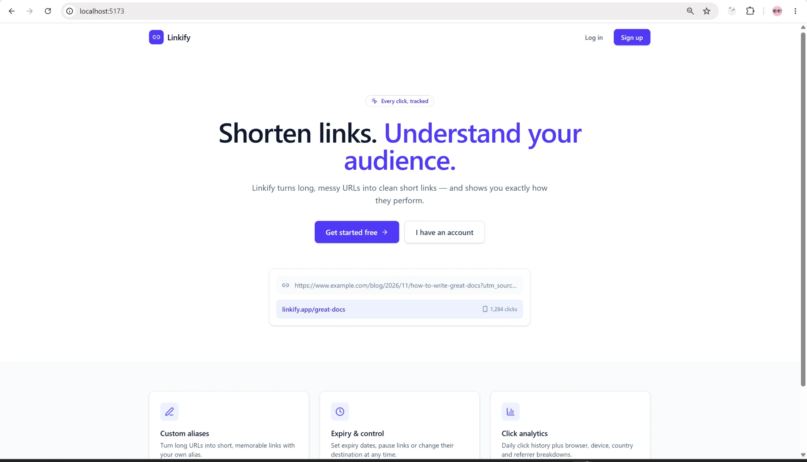
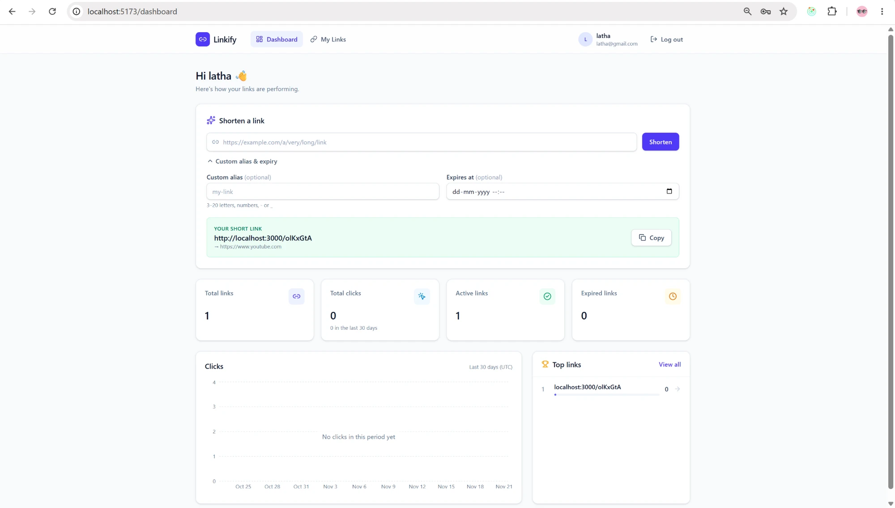
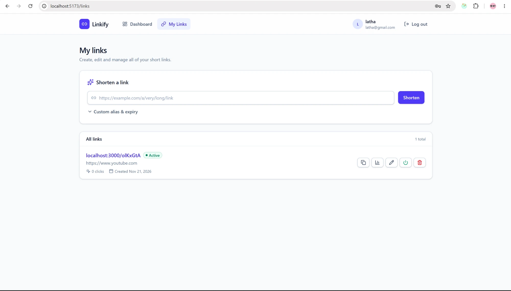
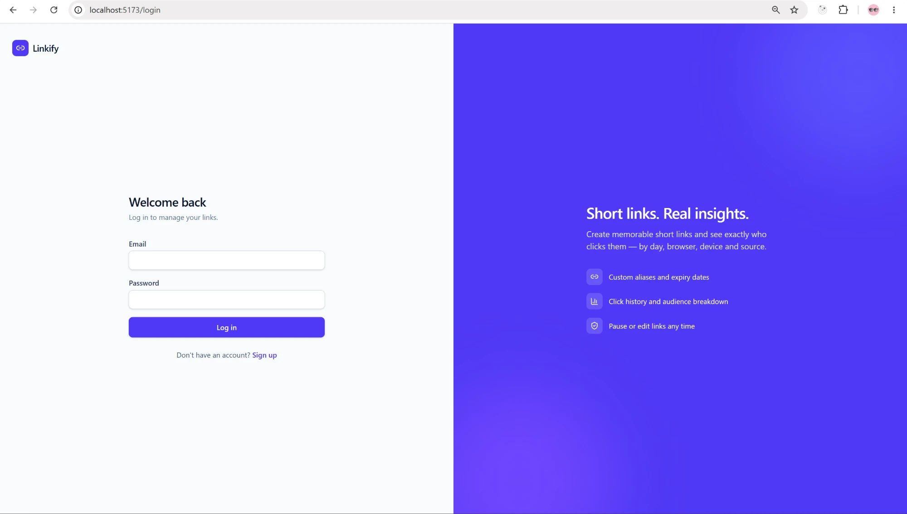
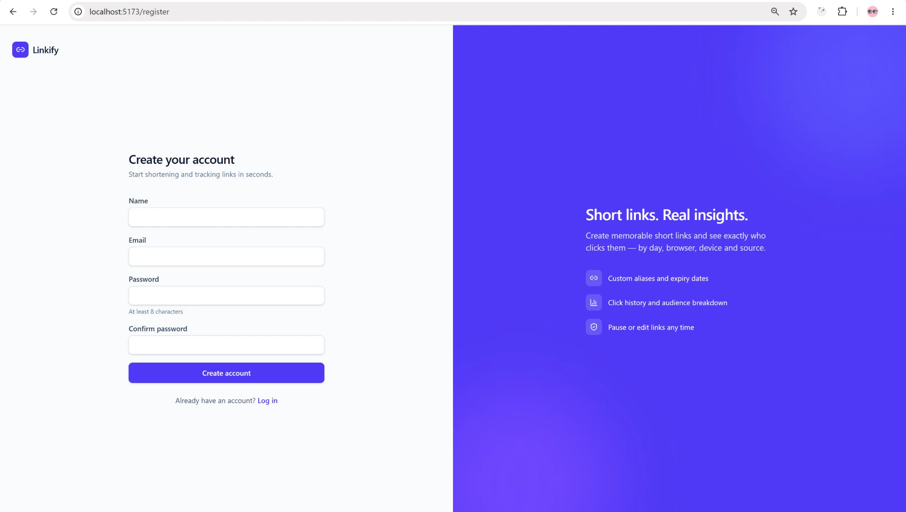

<div align="center">

# 🔗 Linkify

**A full-stack URL shortener with click analytics.**
Shorten long URLs, set custom aliases and expiry dates, and see who clicks your links: by day, browser, device, referrer and country.

**[🚀 Live Demo](#-live-demo)** · **[✨ Features](#-features)** · **[📸 Screenshots](#-screenshots)** · **[⚙️ Getting Started](#️-getting-started)** · **[📡 API](#-api-reference)**




</div>

---

## 🚀 Live Demo

| | Link |
|---|---|
| **Frontend** | _Coming soon_ |
| **API** | _Coming soon_ |

<!-- After deploying, replace "Coming soon" with your links, e.g.
| **Frontend** | https://linkify.vercel.app |
| **API**      | https://linkify-api.onrender.com/api/v1/health |
-->

---

## ✨ Features

**Links**
- Shorten any `http`/`https` URL into a 7-character short code
- **Custom aliases** (e.g. `/my-portfolio`), with reserved words blocked
- **Expiry dates**: links stop working automatically after a set date and time
- **Activate / deactivate** links without deleting them
- Edit the destination URL or alias, copy to clipboard, and delete links
- Paginated list of all your links

**Analytics**
- Dashboard with total links, total clicks, and counts of active and expired links
- Daily click history (7 days / 30 days / 90 days / 1 year)
- Breakdown by **browser, device, referrer and country**
- Top-performing links ranking

**Security**
- JWT authentication with bcrypt password hashing
- Request validation with `express-validator`
- Rate limiting on auth, link creation and API routes
- Helmet security headers, CORS, NoSQL-injection sanitization, 10 KB body limit
- Centralized error handling

---

## 📸 Screenshots

### Dashboard
Overview of all links, total clicks, a 30-day click chart and top links. You can also shorten a new link here.



### My Links
Manage every link: copy, view analytics, edit, activate/deactivate or delete.



### Authentication

| Login | Register |
|---|---|
|  |  |

---

## 🛠️ Tech Stack

| Layer | Technologies |
|---|---|
| **Frontend** | React 19, React Router 7, Tailwind CSS 4, Vite, Axios, Recharts, Lucide icons |
| **Backend** | Node.js, Express 5, MongoDB Atlas, Mongoose |
| **Auth & Security** | JWT, bcrypt, express-validator, express-rate-limit, Helmet, CORS, express-mongo-sanitize |
| **Other** | nanoid (short codes), compression, concurrently (runs both apps) |

---

## 📁 Project Structure

```
Linkify/
├── BACKEND/
│   ├── config/          # MongoDB connection
│   ├── controllers/     # Request handlers
│   ├── middlewares/     # Auth, rate limiting, error handling
│   ├── models/          # User, Url, Analytics schemas
│   ├── routes/          # auth, urls, analytics, redirect, health
│   ├── services/        # Business logic
│   ├── utils/           # JWT, short code, user-agent parsing
│   ├── validators/      # express-validator rules
│   ├── app.js
│   └── server.js
├── FRONTEND/
│   └── src/
│       ├── api/         # Axios client and endpoint functions
│       ├── components/  # Reusable UI components
│       ├── context/     # Auth and toast providers
│       ├── pages/       # Landing, Login, Register, Dashboard, Links, LinkDetails
│       └── utils/       # Formatting helpers
└── package.json         # Runs both apps with one command
```

---

## ⚙️ Getting Started

### Prerequisites
- Node.js **22.12+**
- A free [MongoDB Atlas](https://www.mongodb.com/atlas) cluster (or local MongoDB)

### 1. Clone and install
```bash
git clone https://github.com/<your-username>/Linkify.git
cd Linkify
npm run install:all
```

### 2. Environment variables

**`BACKEND/.env`**
```env
PORT=3000
MONGO_URI=mongodb+srv://<user>:<password>@<cluster>.mongodb.net/linkify
JWT_SECRET=<a-long-random-string>
JWT_EXPIRES_IN=7d
BASE_URL=http://localhost:3000
CLIENT_URL=http://localhost:5173
```

To generate a strong `JWT_SECRET`:
```bash
node -e "console.log(require('crypto').randomBytes(48).toString('hex'))"
```

**`FRONTEND/.env`**
```env
VITE_API_URL=http://localhost:3000/api/v1
```

### 3. Run
```bash
npm run dev
```
- Frontend: http://localhost:5173
- API: http://localhost:3000/api/v1
- Short links redirect from: `http://localhost:3000/<shortCode>`

---

## 📡 API Reference

Base URL: `/api/v1`. All routes except auth, health and redirect need the header `Authorization: Bearer <token>`.

### Auth
| Method | Endpoint | Description |
|---|---|---|
| `POST` | `/auth/register` | Create an account |
| `POST` | `/auth/login` | Log in and receive a JWT |
| `GET` | `/auth/me` | Get the current user |
| `POST` | `/auth/logout` | Log out |

### URLs
| Method | Endpoint | Description |
|---|---|---|
| `POST` | `/urls/shorten` | Create a short URL (`originalUrl`, optional `customAlias`, `expiresAt`) |
| `GET` | `/urls?page=1&limit=10` | List your URLs (paginated) |
| `GET` | `/urls/:id` | Get one URL |
| `PUT` | `/urls/:id` | Update the URL, alias, expiry or active status |
| `DELETE` | `/urls/:id` | Delete a URL |

### Analytics
| Method | Endpoint | Description |
|---|---|---|
| `GET` | `/analytics/dashboard` | Totals and clicks by date |
| `GET` | `/analytics/top-links?limit=5` | Most-clicked links |
| `GET` | `/analytics/urls/:urlId/summary` | Click summary for one link |
| `GET` | `/analytics/urls/:urlId/history?days=30` | Daily clicks (1–365 days) |
| `GET` | `/analytics/urls/:urlId/breakdown` | Browser, device, referrer and country stats |

### Public
| Method | Endpoint | Description |
|---|---|---|
| `GET` | `/api/v1/health` | Health check |
| `GET` | `/:shortCode` | Redirect to the original URL and record the click |

---

## 👤 Author

**Your Name**
- GitHub: [@your-username](https://github.com/your-username)
- LinkedIn: [your-linkedin](https://linkedin.com/in/your-linkedin)

---

<div align="center">

⭐ If you found this project useful, consider giving it a star!

</div>
